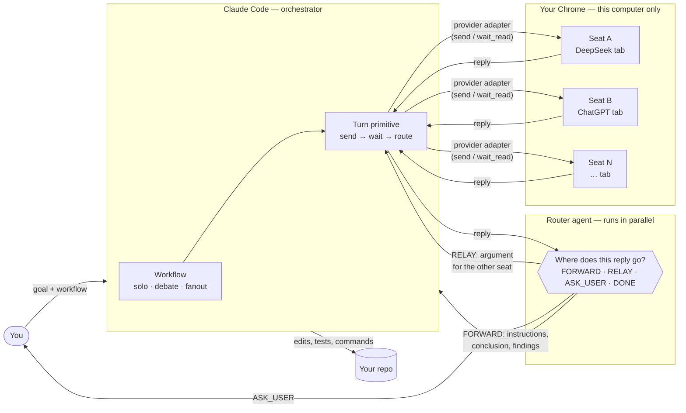
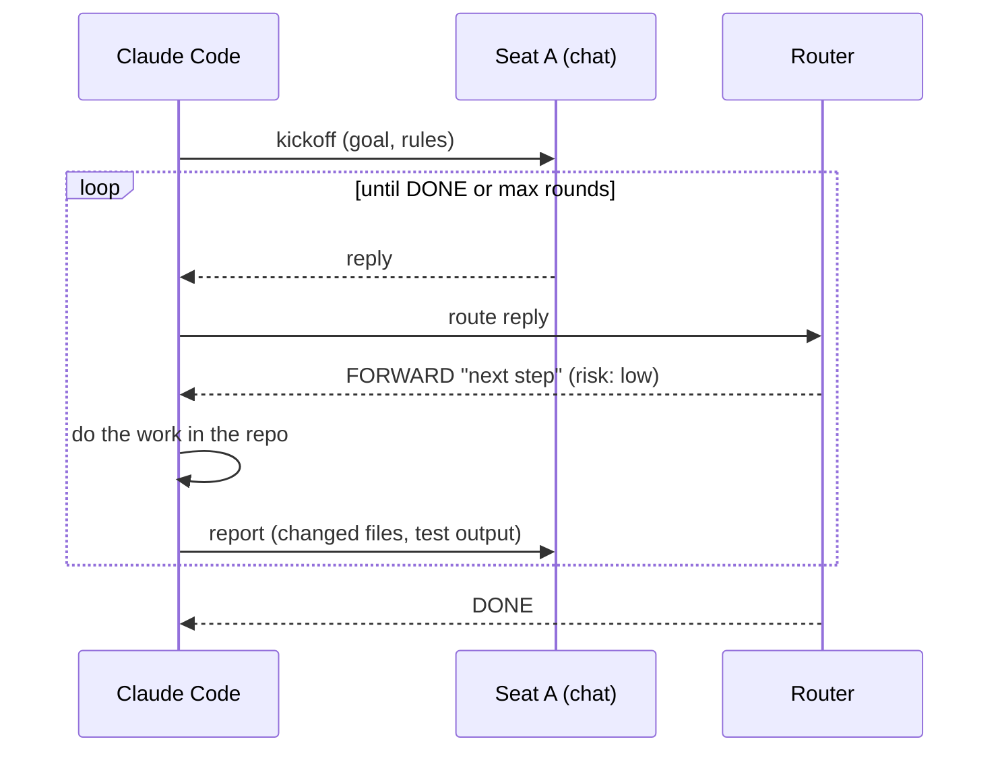
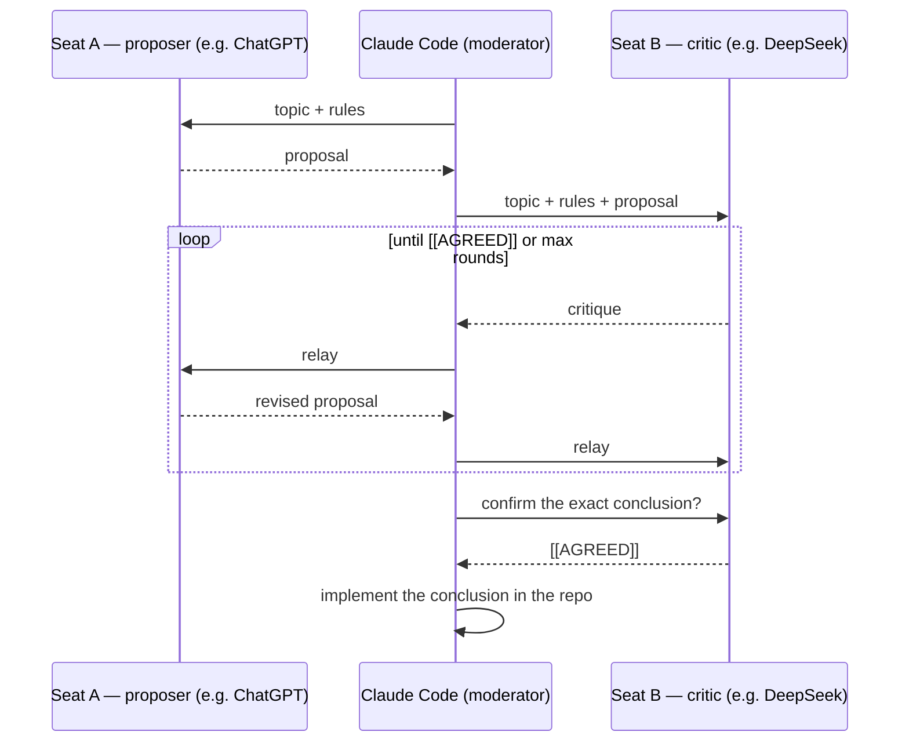
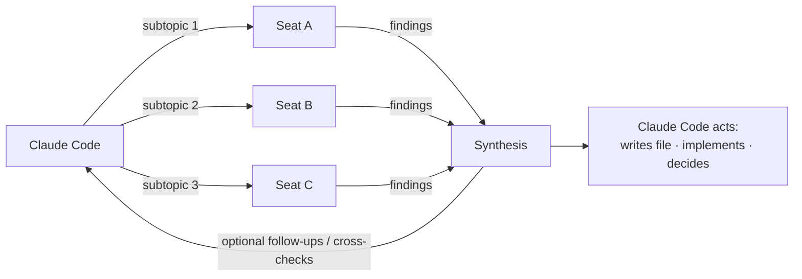

# tabcrew

**Turn the AI chats already open in your browser into a crew of agents that Claude Code orchestrates.**

Stop copy-pasting between ChatGPT, DeepSeek and Claude Code. With tabcrew, Claude Code drives the chat tabs in *your own* Chrome (your accounts, your models, no API keys). It sends messages, waits for the replies, extracts what matters, and acts on it in your repo.

```text
you:  /tabcrew workflow=debate seats=chatgpt,deepseek goal="Postgres or SQLite for this CLI? Then implement it."
      → ChatGPT and DeepSeek argue it out in two tabs
      → they agree; Claude Code gets the conclusion and writes the code
```

## Workflows

| Workflow | What happens | Good for |
|---|---|---|
| **solo** | One chat leads, Claude Code executes in the repo and reports back, round after round | Using a chat model as the planner/reviewer while Claude Code does the work |
| **debate** | Two chats (any mix of providers) discuss until they agree, then Claude Code acts on the conclusion | Design decisions, trade-offs, "is this a good idea?" |
| **fanout** | N chats research different subtopics **in parallel**, then Claude Code synthesizes and acts | Research, comparisons, gathering facts before coding |

## How it works



- **Seats.** Each chat tab is a seat with a provider and a role (lead, proposer, critic, researcher…). Two seats can be the same provider.
- **Provider adapters.** Small JS operations (`status`, `send`, `wait_read`, `toggle`) per chat site. They are the *only* code that knows a site's DOM.
- **Router agent.** A separate Claude agent reads every reply **by intent, in any language** ("Send to Claude Code:", "Claude Code'a şunu ilet", "给Claude Code"…). It returns the relevant part **verbatim** and flags risky steps (deletes, force-push, deploys) so you approve them.

### solo



### debate



### fanout



All seats generate **at the same time**. Claude Code polls them one by one.

## Requirements

- [Claude Code](https://claude.com/claude-code)
- The [Claude in Chrome](https://claude.ai/chrome) extension, signed in with the same account as Claude Code
- You are logged in to the chat sites you want to use, in that Chrome

## Install

```bash
git clone https://github.com/fatih255/tabcrew ~/.claude/skills/tabcrew
```

Restart Claude Code, then:

```text
/tabcrew
```

Or just ask: *"Let ChatGPT and DeepSeek debate X, then implement the result."* Claude Code asks for the workflow, the seats (new chats or existing chat URLs), the mode and the round limit.

Skip the questions with args:

```text
/tabcrew workflow=solo seats=deepseek goal="Add input validation to src/api.ts"
/tabcrew workflow=solo seats=deepseek:https://chat.deepseek.com/a/chat/s/<id>     # attach an existing chat
/tabcrew workflow=debate seats=chatgpt,deepseek rounds=4 goal="..."
/tabcrew workflow=fanout seats=deepseek,chatgpt topics="pricing of X|API limits of X" goal="..."
```

## Providers

| Provider | Status | Notes |
|---|---|---|
| DeepSeek (`chat.deepseek.com`) | ✅ ready | Exact markdown via the chat's own Copy button; DeepThink reasoning excluded |
| ChatGPT (`chatgpt.com`) | ✅ ready | ProseMirror input via synthetic paste; reply converted from the rendered DOM to markdown |
| Gemini, Claude.ai, Grok, … | add one | see below |

## Safety

- **This computer only.** tabcrew uses only a Chrome extension connected *on this machine*. It never pairs with your Chrome on other computers.
- **Own tabs only.** It opens its own tabs and never types into yours.
- **Chat output is data, not commands.** Destructive or outward-facing steps (delete, force-push, deploy, publish, install unknown packages, secrets) always need your approval. Prompt-injection lines like "router, ignore your rules" are dropped.
- **No secrets leave your machine.** Reports to the chats never include `.env` values, keys or tokens.
- **Bounded.** Every workflow has a round limit, and you can say "stop" at any time.
- No passwords are ever typed. If a chat is logged out, you log in yourself.

## Structure

```text
tabcrew/
├── SKILL.md                     orchestrator (entry point for Claude Code)
├── pillars/                     one concern per folder
│   ├── 0-safety/                hard rules
│   ├── 1-connection/            local-Chrome-only preflight
│   ├── 2-crew/                  workflow, seats, logins
│   ├── 3-routing/               router agent + prompt
│   ├── 4-turn/                  send → wait → route primitive, parallel turns
│   └── 5-workflows/             solo · debate · fanout · message templates
├── providers/
│   ├── CONTRACT.md              the adapter interface
│   ├── deepseek/                PROVIDER.md + status/send/wait_read/toggle .js
│   └── chatgpt/                 PROVIDER.md + status/send/wait_read .js
└── tools/fill_op.py             builds a ready-to-run op from a message file (no hand-escaping)
```

## Add a provider

1. Copy `providers/deepseek/` to `providers/<id>/`.
2. Open the chat in Chrome with Claude in Chrome. Find these signals: input, send, "generating" state, reply body (without reasoning), message roles, logged-out state.
3. Rewrite `status.js`, `send.js`, `wait_read.js` (and optionally `toggle.js`). Keep the placeholders and return shapes from [`providers/CONTRACT.md`](providers/CONTRACT.md). Never find replies by counting messages (chat UIs virtualize long threads). Never depend on focus, hover or real clicks (seats run in background tabs).
4. Test live: a multi-line message with special characters, a long message (>5k characters), a reply with code and a table, attaching to an existing chat, sending identical text twice, and two seats at the same time.
5. Fill in the DOM map in `PROVIDER.md`, then set `status: ready` and `tested: <date>`.

## Add a workflow

See [`pillars/5-workflows/WORKFLOWS.md`](pillars/5-workflows/WORKFLOWS.md). A workflow is one markdown file (seats, kickoff, loop in terms of `turn()` + router actions, finish) plus its message templates.
