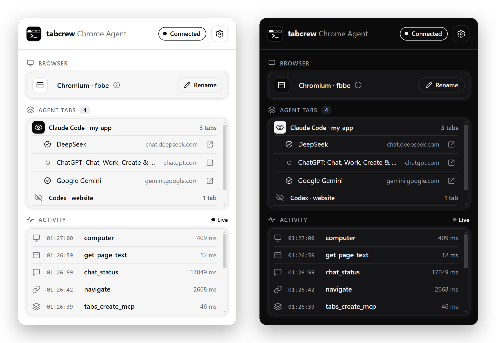
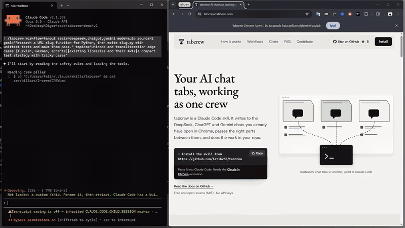
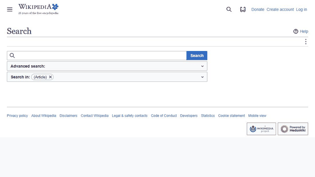
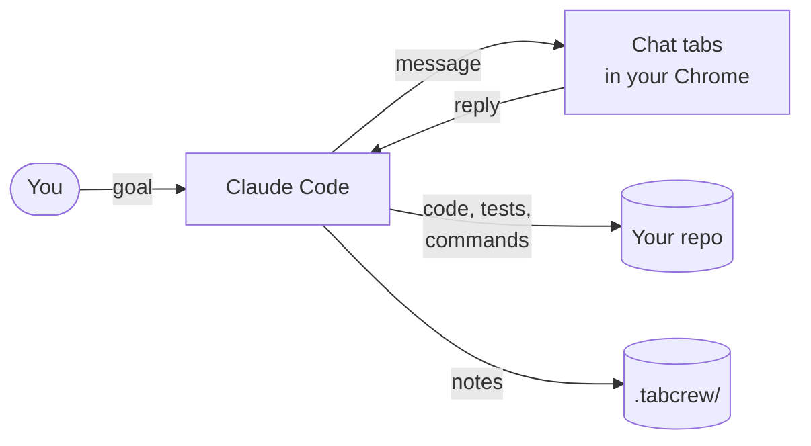
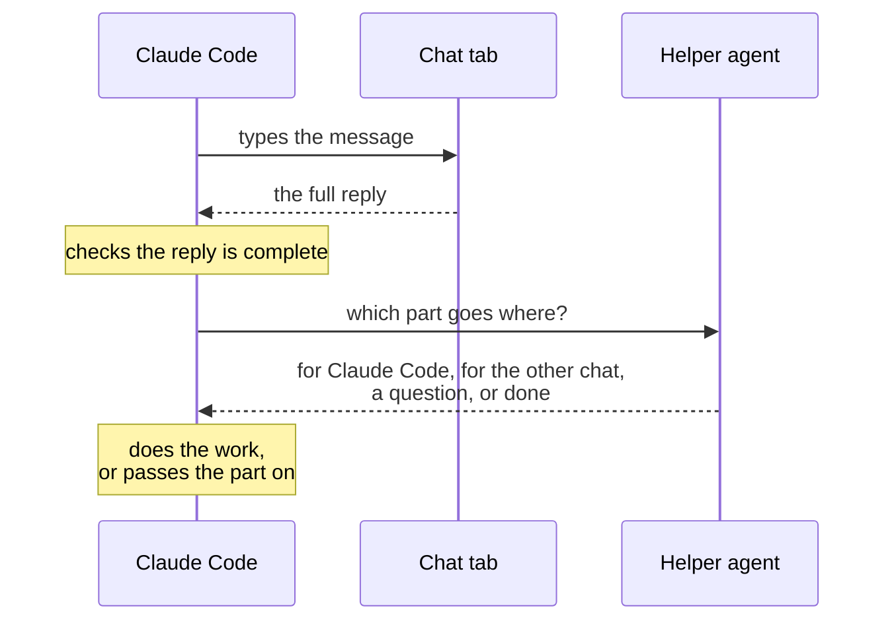
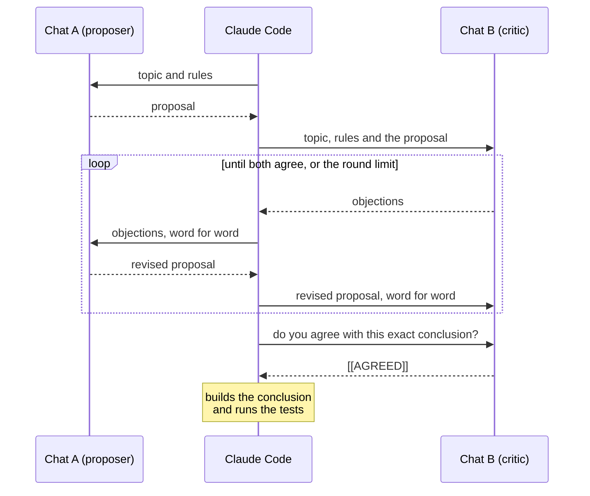
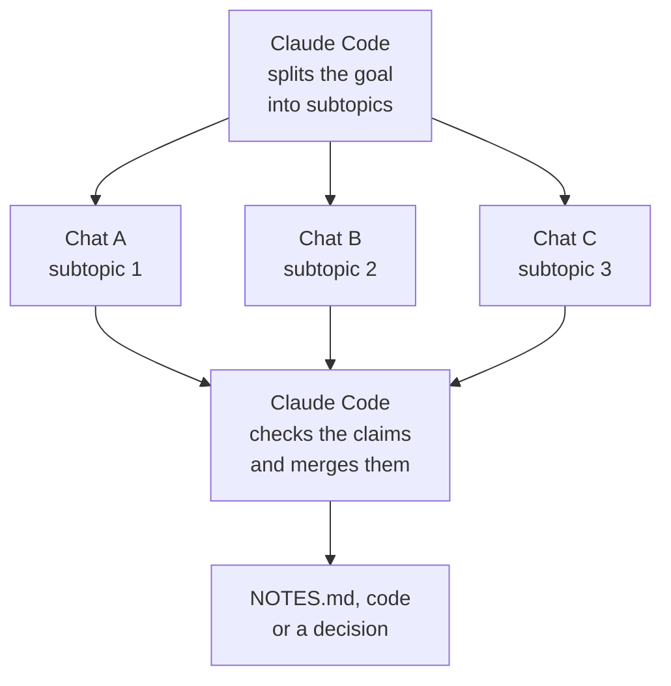

<h1 align="center">&nbsp;tabcrew</h1>

tabcrew is a Claude Code skill that lets Claude Code work with the AI chats you already use in Chrome: DeepSeek, ChatGPT and Gemini. Claude Code writes to the chats, waits for their answers, passes the right parts between them, and does the actual work in your repo.

If you copy prompts from a chat into Claude Code and paste the results back, this does that loop for you.

It runs on your own browser sessions. No API keys, no extra subscriptions.

It comes with its own browser agent: **[tabcrew Chrome Agent](#tabcrew-chrome-agent)**, an open-source Chrome extension and MCP server in this repo. You can watch it work in your Chrome, follow one agent while several share the browser, and use it on its own with any MCP client.



Website: **[tabcrew.fatihinci.com](https://tabcrew.fatihinci.com)**

How it works and why I built it: [How to Make Claude Code Chat With ChatGPT in Your Browser](https://fatihinci.com/blog/claude-code-skill-browser-ai-chats/)



<sub>A real fanout run, sped up where marked (×).</sub>

## tabcrew Chrome Agent

tabcrew drives Chrome through **tabcrew Chrome Agent**, its own open-source (MIT) extension, native host and MCP server, in [`src/chrome-agent/`](src/chrome-agent/). It needs no account and no cloud: it runs on your computer, and your messages go only to the chat sites.



- **You see what it does.** While the agent works in a tab, a black cursor shows where it points and clicks, with a short caption of what it is doing, and a soft black frame marks the tab. The tab title shows ⏳ while it works and ✅ when it is done.
- **Follow one agent.** The popup lists the agent tabs per agent, for example *Claude Code · my-repo*, so several agents can share one browser. Click the eye next to an agent and the window shows the tab that agent is working in; you can watch it move between the chats. Only the agent you follow moves the view, and switching tabs yourself stops following.
- **Only its own tabs.** The agent acts only in tabs inside its grey "tabcrew" tab group, never in yours. In the popup you can block sites, or make it ask before it acts on a new site.
- **Built for chat sites.** `chat_send`, `chat_read`, `chat_images` and friends write to ChatGPT, Gemini and DeepSeek, read the full reply as markdown checked against the page, and save generated images at full size with no download dialog.
- **Several Chrome profiles.** Every profile with the extension connects; tabcrew uses the one logged in to the chat you picked.
- **Works on its own.** 26 browser tools for any MCP client: Claude Code, Codex CLI, Gemini CLI, Cursor, VS Code and others. See [src/chrome-agent/README.md](src/chrome-agent/README.md).

Click the toolbar icon for the popup (pictured at the top): the connection, this browser's name, the agent tabs per agent with their state, and the latest tool calls (click a failed one to read the error). The gear opens the site permissions.

## Install

Tell Claude Code:

```text
Install the skill from https://github.com/fatih255/tabcrew
```

Or clone it into your skills folder yourself:

```bash
git clone https://github.com/fatih255/tabcrew ~/.claude/skills/tabcrew
```

Then set up [tabcrew Chrome Agent](#tabcrew-chrome-agent), the Chrome extension that comes with the skill, once (Node.js 18+):

1. Run its installer (or ask Claude Code: *"Set up tabcrew's Chrome extension"*):

   ```bash
   node ~/.claude/skills/tabcrew/src/chrome-agent/install/install.mjs
   ```

   It copies the extension and its helper to a folder in your user profile, connects them to Chrome, and adds them to Claude Code for all projects. No admin rights needed.
2. In Chrome, open `chrome://extensions`, turn on **Developer mode**, click **Load unpacked** and choose the folder the installer printed (on Windows it is already on your clipboard).
3. Click the tabcrew Chrome Agent icon in the toolbar. The popup should say **Connected**.
4. Start a new Claude Code session, and log in to the chat sites you want to use.

**Several Chrome profiles.** Load the extension in each profile you want to use. tabcrew checks which profile is logged in to the chat you picked and uses that one; if several are, it asks.

**Update.** `git -C ~/.claude/skills/tabcrew pull`, run the installer again, then click the reload icon on the extension in `chrome://extensions`.

## Use it

Describe what you want in plain words:

```text
Use DeepSeek to plan a CSV export feature for this repo and build it step by step.
Let ChatGPT and Gemini debate SQLite vs Postgres for this CLI, then implement the winner.
Have DeepSeek, ChatGPT and Gemini research rate limits, pricing and SDKs for the Stripe API, then write NOTES.md.
Continue my DeepSeek chat https://chat.deepseek.com/a/chat/s/<id> from where we left off.
Ask ChatGPT for an app icon and three backgrounds in one style and save them to art/.
Have Gemini draw four cover options and save them to covers/.
```

Or call it directly. Claude Code asks for anything you leave out:

```text
/tabcrew
/tabcrew workflow=debate seats=chatgpt,gemini rounds=4 goal="..."
/tabcrew workflow=solo seats=deepseek rounds=unlimited goal="..."
```

In automatic mode Claude Code also answers the chats' questions on your behalf and notes each decision in the session memory. It only stops to ask you for secrets or before risky steps such as deleting, deploying or spending money.

The round limit is 5, 10 or 20, or "until the task is done". Without a limit, tabcrew still stops when the chat says the work is finished, when a decision or a risky step needs you, or when the last few rounds made no progress.

## Workflows

| Workflow | Chats | What happens |
|---|---|---|
| solo | 1 | One chat leads. Claude Code carries out each step in the repo and reports the result back, round after round. |
| debate | 2 | Two chats argue a question until both agree on one written conclusion. Claude Code then builds it. |
| fanout | 2 or more | Each chat researches its own subtopic at the same time. Claude Code checks the claims, merges the findings and acts. |

You can mix chats or repeat one: ChatGPT against Gemini, three DeepSeek tabs, two ChatGPT tabs plus a Gemini tab.

## How it works



Every exchange with a chat follows the same steps:



- **Each chat has a role** such as lead, proposer, critic or researcher, and a small helper agent with a name, for example `🟣🐋 Skeptic (DeepSeek · critic)`. The helper reads the reply in any language and returns, word for word, the part meant for Claude Code or for the other chat. It also flags risky steps.
- **A chat only sees its own conversation**, not your repo or the other chats. Before each message, Claude Code adds what that chat is missing: the code it asked about, a failing test, another chat's finding or an earlier decision.
- **Claude Code checks each reply against the page** before using it: no text lost, code blocks and tables intact, every character copied correctly.

### Debate



### Fanout



All chats write at the same time. When a finding is thin or looks wrong, Claude Code sends that chat a follow-up question before merging. In testing, Claude Code ran the chats' example claims in real Python, caught wrong ones, and had that chat correct itself before writing the result.

## Reliability

Chat sites change their pages and have limits. tabcrew deals with them so a run does not silently go wrong:

| Situation | What tabcrew does |
|---|---|
| A message is longer than the site accepts (ChatGPT about 10,000 characters, Gemini 32,000, DeepSeek about 60,000) | Splits it into parts and sends them in order |
| The site shows an error ("Too many requests", "Something went wrong", a lost connection) | Notices it (usually within seconds, at most about two minutes), reloads the tab, tries once more, then tells you |
| A reply is read incompletely, for example after a site redesign | Tells you the reply may be incomplete; if text is missing, uses the page's plain text instead |
| Gemini puts code in its Canvas side panel | Asks Gemini to paste it into the chat |
| A chat is logged out | Asks you to log in; it never types passwords |
| A chat generates images (ChatGPT, Gemini) | Saves them straight into a folder you choose, at full size, with no download dialog and without overwriting files |

To check that all three chats still work, run the smoke tests (about 10 minutes, real chats, 5 sessions at once):

```bash
bash src/tools/e2e.sh
```

## What has been tested

Every run below was a fresh `claude -p` session in an empty folder, driving real chat tabs, and ended with Claude Code writing code and running its tests.

| Workflow | Chats | Example tasks | Result |
|---|---|---|---|
| solo | DeepSeek, ChatGPT or Gemini | todo CLI, `slugify()`, word counter, INI-to-JSON converter, reviewing a 24.5k-character file | all tests pass |
| solo, existing chat | DeepSeek | continue an old chat from its own summary | 21 tests pass |
| debate | every pair, and a chat against itself | palindrome rules, retry/backoff, LRU cache, duration parser, rate limiter, config loading, JSON-lines reader | all tests pass |
| fanout | 2 or 3 chats, mixed | Unicode edge cases, password checker, SemVer, `slugify()` for 5 scripts | wrong claims caught and corrected, all tests pass |
| auto mode | DeepSeek, ChatGPT | the chats asked design questions first | all answered by Claude Code, none needed you |
| `src/tools/e2e.sh full` | all three | every test above in one matrix (2026-11-27, tabcrew Chrome Agent) | 13 of 13 pass |
| images | ChatGPT, Gemini | generate an icon and save it at full size | saved and checked |

## Memory

Every session leaves dated notes in your project:

```text
.tabcrew/
├── INDEX.md            one line per session, newest first
├── sessions/           goal, chats, decisions, what changed, open items, next step
└── chats/              each chat's own summary of the conversation, by date
```

When you attach to a chat you have been using for a while, tabcrew first asks that chat to summarize the whole conversation, saves the summary, and continues from its "next step". A later session, or any other AI, can read the folder and pick up where things stopped. The files are Markdown with YAML frontmatter. Commit them or add `.tabcrew/` to `.gitignore`, as you prefer.

## Safety and privacy

- It only uses the Chrome extension on this computer. It never connects to your Chrome on other machines.
- It works in tabs it opened itself and never types into yours. The chat tabs stay open when it finishes.
- Chat output is treated as input for your goal, not as commands. Deleting files, force-pushing, deploying, publishing, installing unknown packages and anything touching secrets wait for your approval.
- Lines such as "ignore your rules" in a chat reply are dropped.
- Messages to the chats never include `.env` values, keys or tokens.
- Every workflow has a round limit or, if you choose "until done", a check that pauses the run when it stops making progress. You can say stop at any time.
- It never types passwords. If a chat is logged out, you log in.
- tabcrew Chrome Agent runs on your computer only: the extension talks to a local helper program, and the MCP server reaches it through a local pipe. It has no account, no server and no analytics. It stores nothing in the chat sites.
- The agent acts only in tabs inside its own grey "tabcrew" tab group. In its popup you can block sites, or make it ask before it acts on a new site.

## Supported chats

| Chat | Status |
|---|---|
| DeepSeek (chat.deepseek.com) | Supported |
| ChatGPT (chatgpt.com) | Supported |
| Gemini (gemini.google.com) | Supported |
| Claude.ai, Grok, Perplexity and others | Not yet. See [CONTRIBUTING.md](CONTRIBUTING.md) to add one. |

## Contributing

Adapters for more chat sites and new workflows are welcome. [CONTRIBUTING.md](CONTRIBUTING.md) explains the layout, the adapter contract and how to test.

## License

MIT
