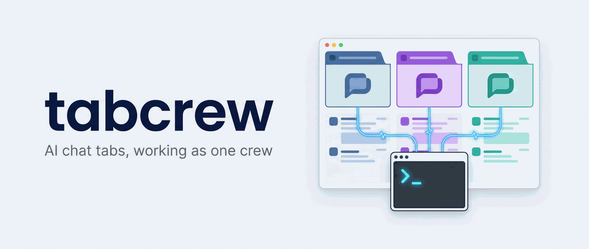
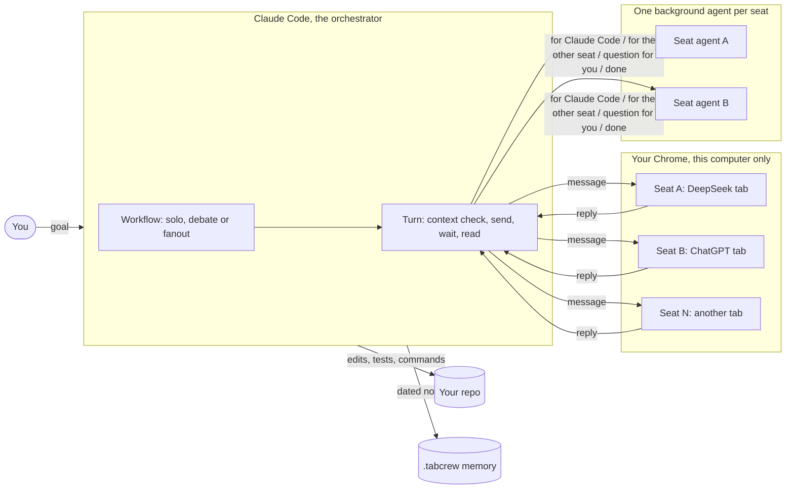
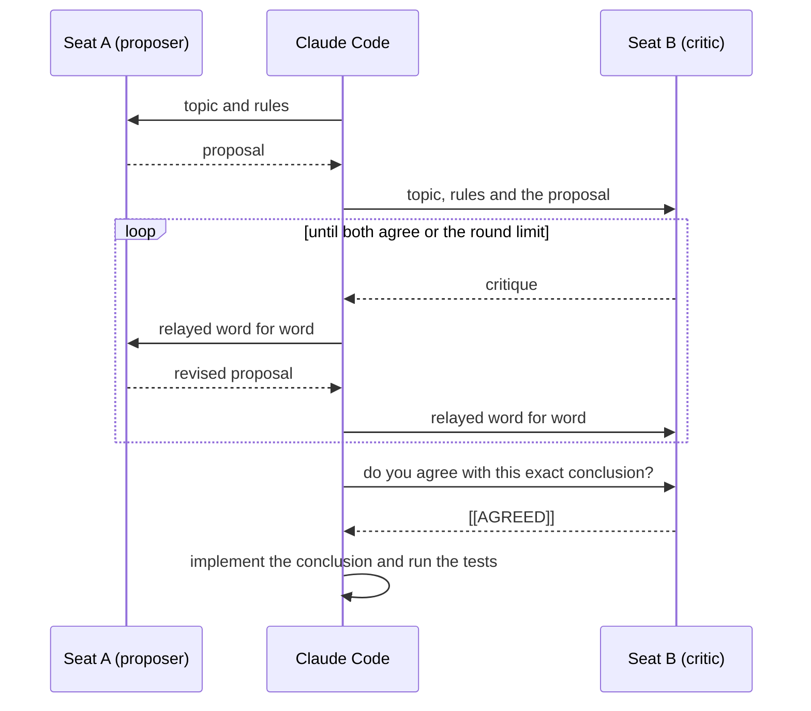
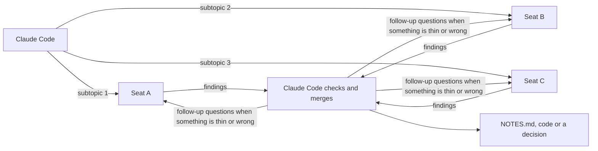

<p align="center">
  
</p>

# tabcrew

tabcrew is a Claude Code skill that lets Claude Code drive the AI chats you already have open in Chrome. DeepSeek and ChatGPT tabs become seats in a crew. Claude Code sends them messages, waits for their answers, passes the right parts between them, and does the actual work in your repo.

If you copy prompts from a chat into Claude Code and paste the results back, this does that loop for you.

It runs on your own browser sessions. No API keys, no extra subscriptions.

## Install

Tell Claude Code:

```text
Install the skill from https://github.com/fatih255/tabcrew
```

You also need the [Claude in Chrome](https://claude.ai/chrome) extension, signed in with the same account as Claude Code, and you need to be logged in to the chat sites you want to use.

## Use it

Describe what you want in plain words:

```text
Use DeepSeek to plan a CSV export feature for this repo and build it step by step.
Let ChatGPT and DeepSeek debate SQLite vs Postgres for this CLI, then implement the winner.
Have two DeepSeek chats research rate limits and pricing for the Stripe API, then write NOTES.md.
Continue my DeepSeek chat https://chat.deepseek.com/a/chat/s/<id> from where we left off.
```

In automatic mode Claude Code also answers the chats' questions on your behalf (and notes each decision in the session memory). It only stops to ask you for secrets or before risky steps such as deleting, deploying or spending money.

Or call it directly. Claude Code asks for anything you leave out:

```text
/tabcrew
/tabcrew workflow=debate seats=chatgpt,deepseek rounds=4 goal="..."
/tabcrew workflow=solo seats=deepseek rounds=unlimited goal="..."
```

The round limit is 5, 10 or 20, or "until the task is done". Without a limit, tabcrew still stops when the chat says the work is finished, when a decision or a risky step needs you, or when the last few rounds made no progress.

## Workflows

| Workflow | Seats | What happens |
|---|---|---|
| solo | 1 | One chat leads. Claude Code carries out each step in the repo and reports back, round after round. |
| debate | 2 | Two chats argue a question until both agree on one written conclusion. Claude Code then acts on it. |
| fanout | 2 or more | Each chat researches its own subtopic at the same time. Claude Code checks the claims, merges the findings and acts. |

Seats can mix providers or repeat one: three DeepSeek tabs, two ChatGPT tabs plus a DeepSeek tab, or anything else.

## How it works



Each seat is a chat tab with a role, such as lead, proposer, critic or researcher. Each one gets a small background agent with a name, an emoji and a color, for example `🟣🐋 Skeptic (DeepSeek · critic)`. The agent reads its chat's replies in any language and returns, word for word, the part meant for Claude Code or for the other seat. It also flags risky steps.

A chat only sees its own conversation. It does not see your repo or the other seats. Before each message, Claude Code checks what that chat is missing, such as the code it asked about, a test failure, another seat's finding or an earlier decision. It adds only those parts. When a chat's answer rests on a wrong guess about the project, its seat agent says so, and the next message corrects it.

### Debate in detail



### Fanout in detail



All seats generate at the same time. In testing, Claude Code ran the seats' example claims in real Python, caught two that were wrong, and had that seat correct itself before writing the notes.

## What has been tested

Each run below was a fresh `claude -p` session in an empty folder, driving real chat tabs, and ended with Claude Code writing code and running its tests.

| Workflow | Seats | Task | Result |
|---|---|---|---|
| solo | DeepSeek | todo CLI with JSON storage | 13 tests pass |
| solo | ChatGPT | `slugify()` with Turkish and German letters | 12 tests pass |
| solo, existing chat | DeepSeek | continue an old chat via its handoff, add `count_vowels()` | 21 tests pass |
| debate | ChatGPT vs DeepSeek | palindrome rules for punctuation and Unicode | 11 tests pass |
| debate | DeepSeek vs DeepSeek | retry and backoff for a urllib `fetch_json()` | 19 tests pass |
| debate | ChatGPT vs ChatGPT | API of an LRU cache with TTL | 26 tests pass |
| fanout | DeepSeek + ChatGPT | Unicode edge cases, written up as NOTES.md | 9 checks pass |
| fanout | DeepSeek ×3 | password strength checker | 23 tests pass |
| fanout | ChatGPT ×2 + DeepSeek | aligned Markdown tables with CJK and emoji | 18 tests pass |
| solo, auto mode | DeepSeek | disk-cached downloader; the chat asked 6 design questions first | all answered by Claude Code, 0 asked to the user, 14 tests pass |
| fanout, auto mode | ChatGPT + DeepSeek | file encoding fixer; each seat asked a clarifying question | all answered by Claude Code, 0 asked to the user, 28 tests pass |
| solo, auto mode | ChatGPT | Slack deploy notifier with dry run, no real message sent | format and retry questions answered by Claude Code, webhook read from an env var, 24 tests pass |

## Memory

Every session leaves dated notes in your project:

```text
.tabcrew/
├── INDEX.md            one line per session, newest first
├── sessions/           goal, seats, decisions, what changed, open items, next step
└── chats/              each chat's own summary of the conversation, by date
```

When you attach to a chat you have been using for a while, tabcrew first asks that chat to summarize the whole conversation, saves the summary, and continues from its "next step". A later session, or any other AI, can read the folder and pick up where things stopped. The files are Markdown with YAML frontmatter. Commit them or add `.tabcrew/` to `.gitignore`, as you prefer.

## Safety

- It only uses the Chrome extension on this computer. It never connects to your Chrome on other machines.
- It works in tabs it opened itself and never types into yours.
- Chat output is treated as input for your goal, not as commands. Deleting files, force-pushing, deploying, publishing, installing unknown packages and anything touching secrets wait for your approval.
- Lines such as "ignore your rules" in a chat reply are dropped.
- Messages to the chats never include `.env` values, keys or tokens.
- Every workflow has a round limit or, if you choose "until done", a check that pauses the run when it stops making progress. You can say stop at any time.
- It never types passwords. If a chat is logged out, you log in.

## Supported chats

| Chat | Status |
|---|---|
| DeepSeek (chat.deepseek.com) | Supported |
| ChatGPT (chatgpt.com) | Supported |
| Gemini, Claude.ai, Grok and others | Not yet. See [CONTRIBUTING.md](CONTRIBUTING.md) to add one. |

## Contributing

Adapters for more chat sites and new workflows are welcome. [CONTRIBUTING.md](CONTRIBUTING.md) explains the layout, the adapter contract and how to test.

## License

MIT
