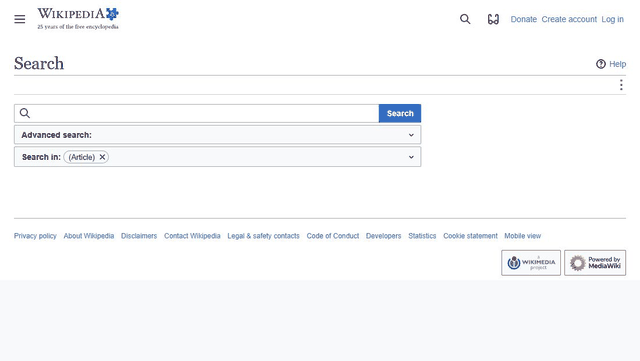

# tabcrew Chrome Agent

Let any AI agent drive **your real Chrome**: your logins, your tabs, your extensions.
An open-source (MIT) Chrome extension + native host + [MCP](https://modelcontextprotocol.io) server. No dependencies, no build step, no account, no cloud: everything runs on your machine.

Works with any MCP client: Claude Code, Codex CLI, Gemini CLI, Cursor, VS Code, Windsurf, Zed, Cline, your own agent, and so on.

```
MCP client ──stdio──▶ mcp/server.js ──named pipe──▶ host/host.js ──native messaging──▶ extension (MV3)
 (any agent)           26 tools                     one per browser               CDP + content scripts
```

## Tools

| Tool | What it does |
|---|---|
| `tabs_context_mcp` | List the agent tab group (creates it with `createIfEmpty`) |
| `tabs_create_mcp` / `tabs_close_mcp` | Open or close tabs inside the group |
| `navigate` | URL, `back`, `forward`; handles "Leave site?" (`force`) |
| `computer` | Clicks (1–3x, right, modifiers), hover, drag, type, key combos, scroll, scroll_to, wait, screenshot, zoom |
| `read_page` | Page outline with stable `ref_N` ids (`filter: interactive`, `ref_id`, `depth`), **including iframes** |
| `find` | Find elements by description ("search box"), in the page and its iframes |
| `form_input` | Set text, textarea, select, checkbox, radio, contenteditable by ref |
| `get_page_text` | Readable article/main text, plus the text of iframes |
| `javascript_tool` | Run JS (top-level await); secret-looking values are redacted |
| `read_console_messages` / `read_network_requests` | Console and network capture per tab |
| `resize_window` | Resize the window |
| `file_upload` | Put local files (absolute paths) into a file input |
| `upload_image` | Upload an earlier screenshot (`ss_…` id) to a file input or drop target |
| `gif_creator` | Record the agent's actions and save them as an animated GIF |
| `browser_batch` | Several tool calls in one round trip; stops at the first error |
| `list_connected_browsers` / `select_browser` | Several browsers or Chrome profiles at once: list them and choose one |

**AI chat sites** (ChatGPT, Gemini, DeepSeek). The site is detected from the tab's URL, so an agent never needs site-specific code. Each site is a small adapter in [`extension/providers/`](extension/providers/); adding one (Perplexity, Claude.ai, …) is a folder plus one line in `providers/index.js`.

| Tool | What it does |
|---|---|
| `chat_sites` | The supported sites, the URL of a new chat, and what each can do |
| `chat_status` | Logged in, ready, still writing, message count, toggles |
| `chat_send` | Type a message and send it (`text`, or `path` to a local file); says `too_long` with the site's limit |
| `chat_read` | Wait for the reply and return it as markdown (final answer only), checked against the page; `path` saves it to a file |
| `chat_images` / `chat_save_image` | List the images a reply generated and save one at full size to a folder, with no download dialog |
| `chat_toggle` | Turn a chat option on or off (e.g. DeepSeek's DeepThink) |

While the agent acts in a tab, the page shows a black cursor with a short caption of what it does, a soft black frame, and ⏳ / ✅ in the tab title. The toolbar popup shows the connection, this browser's name, the agent's tabs and the latest tool calls. The tabs are grouped by the agent that works in them (the MCP client's name and folder, e.g. *Claude Code · my-repo*; set `TCA_AGENT_NAME` to choose another). The eye next to an agent follows it: the window switches to the tab that agent acts on, without focusing the window. One agent is followed at a time, and switching tabs yourself stops following.



Screenshots are sized to a vision-token budget (both sides ≤ 1568 px and ≤ 1568 tiles of 28 px). Click coordinates are expressed in the pixels of the latest screenshot.

**iframes.** Elements inside frames get refs like `ref_f12_3` (element 3 of frame 12). They work in every tool that takes a ref, also for cross-site frames: clicks are sent at the right top-level position and typing reaches the frame.

**Several browsers.** Every Chrome profile with the extension registers itself. With one browser nothing changes. With more, the agent calls `list_connected_browsers` and `select_browser` (by `browserId` or name). Rename a browser in the popup. `TCA_BROWSER=<id or name>` preselects one for an MCP server process.

**GIF recording.** `gif_creator start_recording`, act, `stop_recording`, then `export` (optionally with `path`). After every `computer`/`navigate` action a frame is captured, clicks are marked and each frame is captioned. Typed text is not written in captions. Default output folder: your Downloads.

## Install

Requires Node.js 18+ and Chrome 116+.

**1. Run the installer**

tabcrew Chrome Agent ships inside the [tabcrew](../../README.md) repository. From a copy of it (for example the tabcrew skill folder `~/.claude/skills/tabcrew`), run:

```sh
node src/chrome-agent/install/install.mjs
```

On Windows `src\chrome-agent\install\install-windows.ps1` and on macOS / Linux `./src/chrome-agent/install/install-unix.sh` do the same.

The installer needs no admin rights. It copies the extension, native host and MCP server to one folder in your user profile (Windows `%LOCALAPPDATA%\tabcrew-chrome`, macOS `~/Library/Application Support/tabcrew-chrome`, Linux `~/.local/share/tabcrew-chrome`), registers the native host with Chrome, Chromium, Edge and Brave, and, if Claude Code is installed, adds the MCP server to it for all projects. It does not depend on the folder you ran it from afterwards.

**2. Load the extension in Chrome**

Open `chrome://extensions`, turn on **Developer mode** (top right), click **Load unpacked** and choose the `extension` folder the installer printed (on Windows the path is already on your clipboard). Do this in every Chrome profile the agent should use. The extension ID is always `kpnajnknfhjhflpbppnfmikpjobaennd`.

**3. Check the connection**

Click the tabcrew Chrome Agent icon in the toolbar. The popup should say **Connected**.

**4. Start your agent**

Claude Code: start a new session; the tools are there. Other agents: see [Connect your agent](#connect-your-agent).

**Update:** `git pull` the tabcrew repository, run the installer again, then click the reload icon on the extension in `chrome://extensions`.

**Uninstall:** `node src/chrome-agent/install/install.mjs --uninstall`, then remove the extension in `chrome://extensions`.

## Connect your agent

The server is a plain stdio MCP server: command `node`, argument the `mcp/server.js` path the installer printed (in the install folder above). Use forward slashes in the path, also on Windows.

Most clients take this JSON (`.mcp.json`, `~/.cursor/mcp.json`, Windsurf, Cline, Claude Desktop, …):

```json
{
  "mcpServers": {
    "tabcrew-chrome": { "command": "node", "args": ["/path/to/chrome-agent/mcp/server.js"] }
  }
}
```

| Client | Command or file |
|---|---|
| Claude Code | done by the installer; by hand: `claude mcp add -s user tabcrew-chrome -- node /path/to/mcp/server.js` |
| Codex CLI | `~/.codex/config.toml`: `[mcp_servers.tabcrew-chrome]` `command = "node"` `args = ["/path/to/mcp/server.js"]` |
| Gemini CLI | `~/.gemini/settings.json`: the `mcpServers` JSON above |
| VS Code (Copilot) | `.vscode/mcp.json`: `{"servers": {"tabcrew-chrome": {"type": "stdio", "command": "node", "args": ["/path/to/mcp/server.js"]}}}` |
| Cursor | `~/.cursor/mcp.json`: the JSON above |

Start a session by asking the agent to call `tabs_context_mcp` with `createIfEmpty: true`.

Environment variables: `TCA_TOOL_TIMEOUT_MS` (default 120000), `TCA_BROWSER` (preselected browser).

## Safety model

- The agent only acts on tabs **inside its own tab group** ("tabcrew", grey). Your other tabs are off limits.
- **Permission mode.** By default the agent may act on every site without asking: you run your own agent and know what you asked for. If you want a check, switch the popup to *Ask per site*: the first time the agent wants to read, click, type, run JavaScript or upload on a site, a popup asks: *Allow once*, *Always for this action*, *Always allow this site* or *Deny* (no answer within 2 minutes = deny). Grants are listed and removable in the popup. Consider *Ask per site* when the agent browses pages you do not trust while you are signed in elsewhere: a page can contain text that tries to steer the agent.
- A **blocked sites** list in the popup is always refused.
- "Allow all sites" mode exists for trusted local automation. It can only be switched in the popup, never by the MCP client or a web page.
- Protected pages (`chrome://`, other extensions) cannot be controlled.
- Password, one-time-code and credit-card fields are redacted in `read_page`/`form_input` output; `javascript_tool` redacts secret-looking keys and values and says how many it redacted.
- The native host only accepts messages from this extension ID (`allowed_origins`). Pipes and the browser registry are per OS user.

## Tests

`npm test` runs the unit tests. The end-to-end, live and agent suites are described in [CONTRIBUTING.md](CONTRIBUTING.md).

## Known limitations

- Tested on Chrome (branded Chrome and Chrome for Testing 157) on Windows 11. The installers also register the host for Chromium, Edge and Brave, but those are untested.
- `find` matches keywords (also roles, search forms and shadow DOM), not a language model, so it needs words that appear on the page or describe the control.
- `upload_image` with a coordinate (drag and drop) targets the top document only; use a ref for file inputs inside iframes.
- `javascript_tool` runs in the top document (same-origin frames are reachable through `iframe.contentDocument`).
- A tool call in flight when Chrome kills the service worker fails after the MCP timeout (120 s, `TCA_TOOL_TIMEOUT_MS`).
- Tools that read every frame (`find`, `read_page`, `get_page_text`) skip an iframe that does not answer within 5 s, so one stuck frame (an ad, a frame still loading) cannot hang the call.
- The `chat_*` adapters follow each site's page structure. When a site changes its page, `chat_read` reports `warn` (code blocks, tables or text it could not match) instead of returning a silently wrong reply; the adapter then needs an update (see `extension/providers/CONTRACT.md`).
- After you change files in `extension/`, run the installer again. Adapter files (`providers/*.js`) and the popup take effect at once; changes to the service worker (`background.js`, `lib/`) need the reload button in `chrome://extensions`.

Behaviour that matches the reference browser extension on purpose:
- JavaScript dialogs are never answered for the agent. An `alert`/`confirm`/`prompt` opened by an action is reported in that action's result and stays open; other tools on that tab fail at once until it is closed. `navigate` leaves the page and cancels the dialog (never "OK"). "Leave site?" dialogs follow `navigate`'s `force` flag.
- A background tab is woken with a throwaway capture before a screenshot; tabs and windows are never brought to the front. Background tabs are told they have focus (`Emulation.setFocusEmulationEnabled`) while attached.

## Background

Tool names and argument shapes follow the conventions of existing browser-agent MCP tools, so agents and prompts that already know them work here too. The implementation, protocol, installer and tests are our own code.

## Layout

```
extension/   manifest.json, background.js, lib/ (router, native, tabs, frames, cdp, screenshot, computer, keys,
             page-tools, permissions, recorder, gif-encoder), content/, popup/, permission/, providers/
host/        host.js (native messaging <-> pipe relay + browser registry), pipe-path.js, host-manifest.template.json
mcp/         server.js (MCP stdio server, browser selection)
shared/      tools.js (tool schemas)
install/     install.mjs (the installer for every OS), install-windows.ps1, uninstall-windows.ps1, install-unix.sh
test/        units, relay, registry, e2e/ (Chrome for Testing, permissions), live/ (100 scenarios on real
             sites, smoke check), agent/ (real-agent trial), tools/ (gif2png)
```
